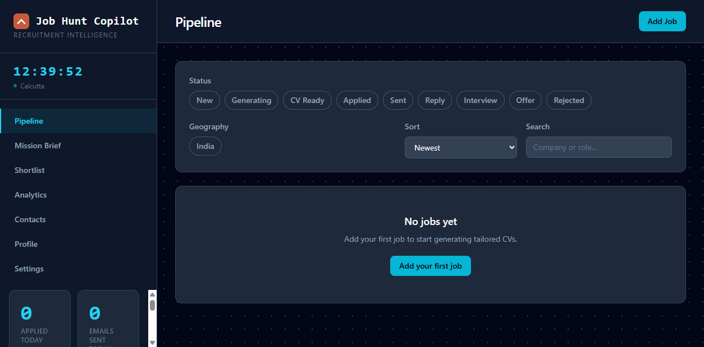
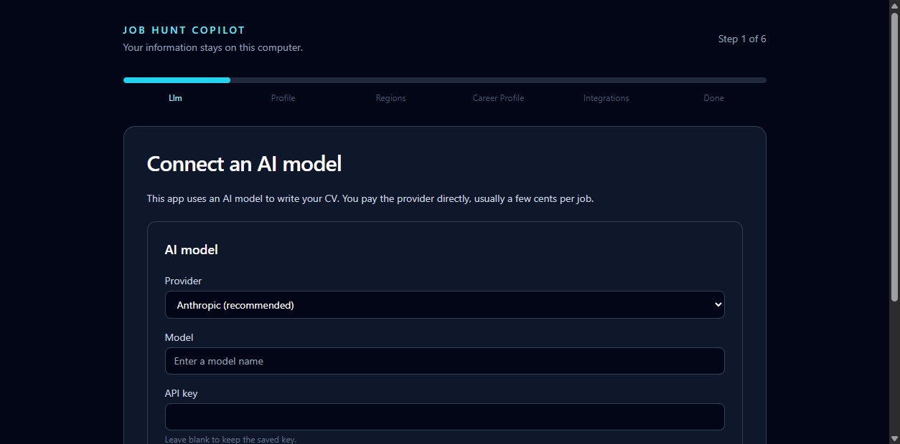
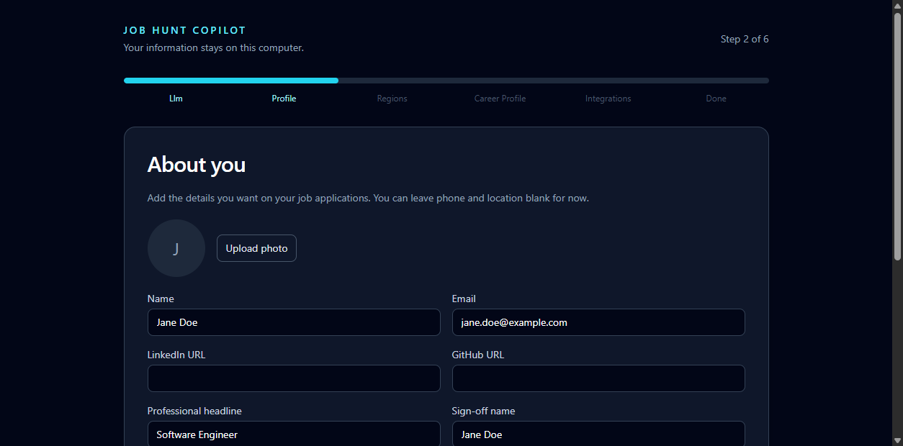
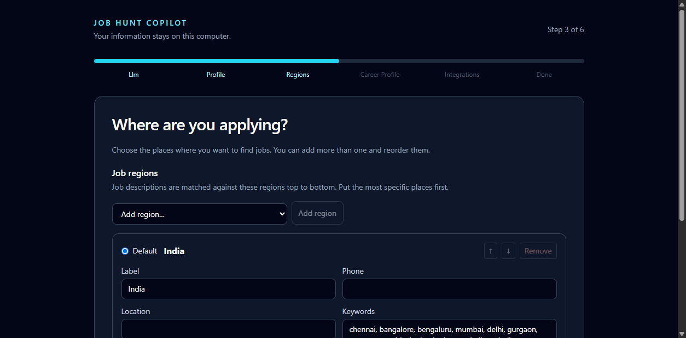
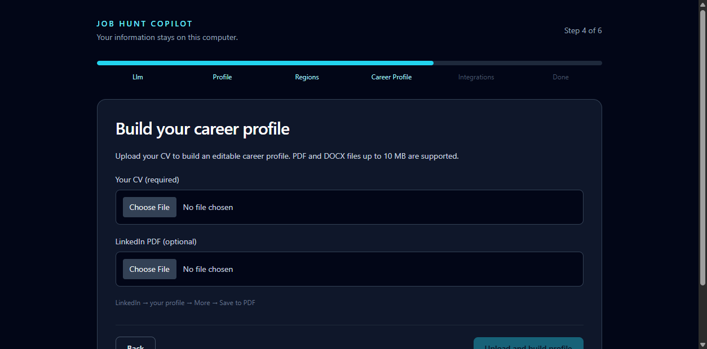
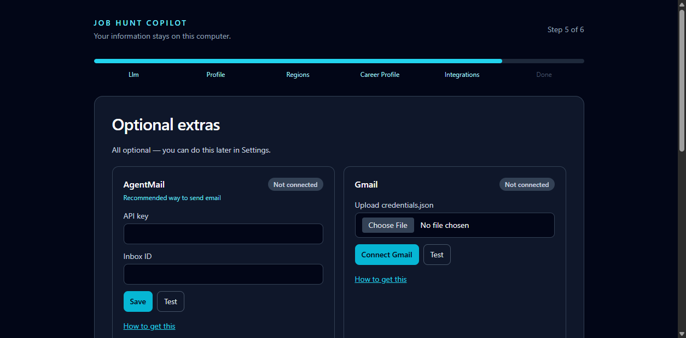
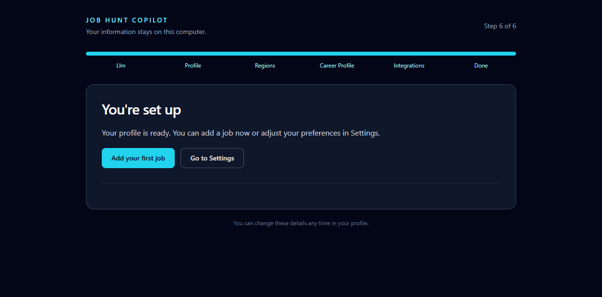

# Job Hunt Copilot

Turn a job description into a tailored CV, application drafts, and a pipeline you can manage on your own computer.

## What it does

- Creates a tailored CV and PDF for each job.
- Drafts a cover letter.
- Checks the CV against the job description for applicant-tracking-system (ATS) fit.
- Prepares outreach drafts for relevant contacts.
- Tracks applications and follow-ups in one pipeline.

Optional connections can help with email, contact discovery, job sourcing, and salary research. You choose which ones to connect.

## What you need

- A Windows 10 or 11 computer, or a Mac from 2018 or newer.
- Docker Desktop, which is free for personal use. [Install Docker Desktop](https://docs.docker.com/desktop/).
- An API key from an AI provider. The provider charges separately for model use.

## Install

1. Install Docker Desktop, open it, and wait until it says the engine is running.
2. On this GitHub page, select the green **Code** button, choose **Download ZIP**, and unzip the folder somewhere easy to find, such as Documents.
3. Double-click `start.bat` on Windows. On Mac, double-click `start.command`. The first time on Mac, right-click the file and choose **Open**.
4. Your browser opens at [http://127.0.0.1:8080](http://127.0.0.1:8080).

The app runs on your computer. You do not need to install Python or Node.js.

## First run

The setup wizard has six steps. Have your current CV and AI provider API key ready.

1. Choose an AI provider, enter its key, choose a model, and test it.

   

2. Add your name and contact details.

   

3. Choose the regions where you want to work.

   

4. Upload your CV. Review the drafted career details and answer any questions before saving them.

   

5. Connect optional services now or skip them and connect them later in Settings.

   

6. Finish setup to open your dashboard.

   

## What it costs

The app itself is free. AI-provider usage is billed by your provider; a typical job may use roughly **$0.05–$0.30**, depending on the model and the work requested. Check your provider's current pricing before use.

Other integrations are optional and may have separate plans or usage charges. Check the provider's pricing page before connecting it. Apify job sourcing is designed to stay within its free monthly credit; usage and provider terms can change.

| Service | Required? | Pricing information |
| --- | --- | --- |
| AI provider | Yes | See the guide for your provider below. |
| AgentMail | No | [AgentMail pricing](https://agentmail.to/pricing) |
| FullEnrich | No | [FullEnrich website](https://fullenrich.com/) |
| Apify | No | [Apify pricing](https://apify.com/pricing) |
| Firecrawl | No | [Firecrawl pricing](https://www.firecrawl.dev/pricing) |
| Gmail | No | [Google Cloud pricing](https://cloud.google.com/pricing) |

## Updating

Double-click `update.bat` on Windows or `update.command` on Mac. Keep Docker Desktop open while it updates.

## Your data

Your profile, settings, applications, uploaded CVs, and generated files live in the `data` folder next to the start script. To back them up, stop the app and copy that folder somewhere safe. To restore, put the copy back in the same place.

The app listens only on your own computer. It sends information to the AI provider you select and to optional services you connect when their features are used. See [Security](SECURITY.md) for details.

## Troubleshooting

- **The page does not open:** make sure Docker Desktop is open and its engine is running. See [Docker is not running](docs/TROUBLESHOOTING.md#docker-is-not-running).
- **Port 8080 is already in use:** see [Port 8080 is in use](docs/TROUBLESHOOTING.md#port-8080-is-in-use).
- **The CV is missing details:** review the knowledge questions and correct your profile, then generate the CV again.
- **The API key is rejected:** check the key in Settings and confirm the provider account is active.
- **Mac blocks the start file:** right-click it and choose **Open** the first time.

See the full [Troubleshooting guide](docs/TROUBLESHOOTING.md).

## For developers

Install Python dependencies with `pip install -r requirements-dev.txt`, run the API with `python api/app.py`, and run the dashboard with `cd dashboard` followed by `npm run dev`. Run tests from the repository root with `pytest`. See [AGENTS.md](AGENTS.md) for the project map and development conventions.

## License

Job Hunt Copilot is released under the [MIT License](LICENSE).
